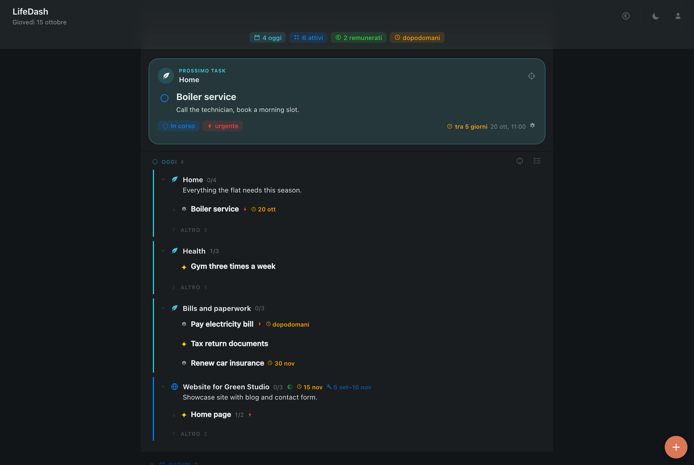
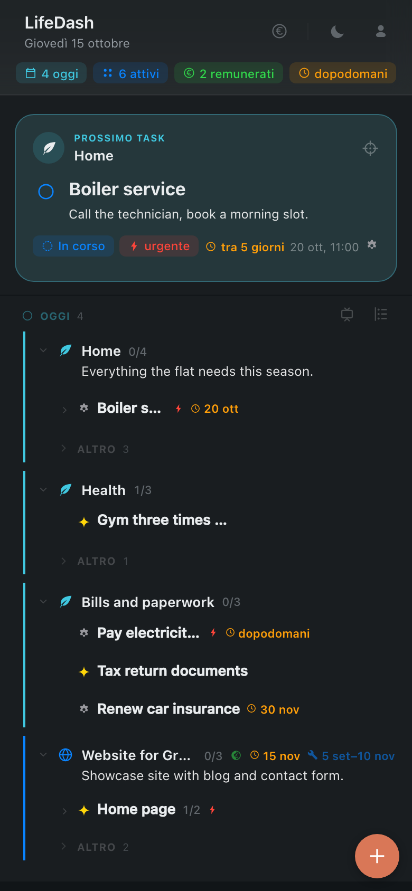
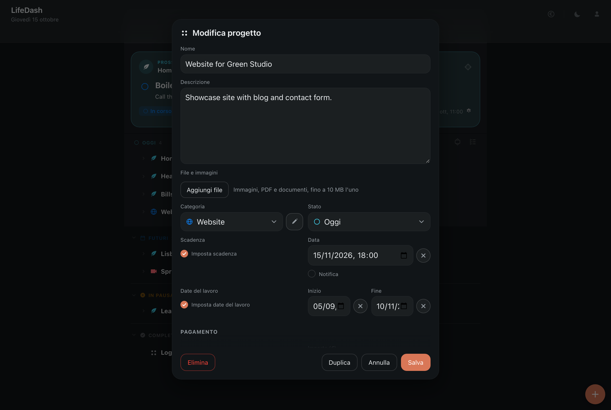
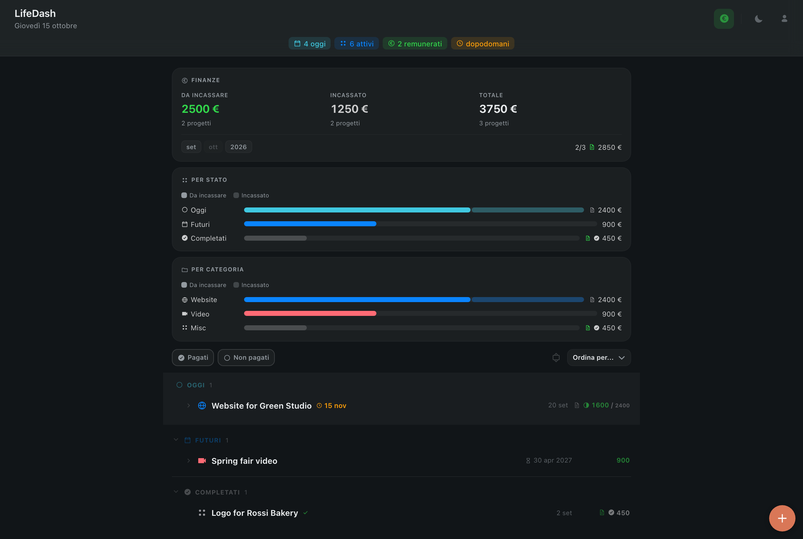

# LIFEDASH

<b><a href="https://github.com/antarcorrado/lifedash/releases/latest/download/LifeDash.zip">Download for Mac</a></b> · <b><a href="https://www.antarcorrado.com/lifedash/">Open the web app</a></b> macOS 13 or later · Apple Silicon and Intel · free

**LifeDash is one calm place for everything you have to do.** The boiler that
needs servicing, the bill due on Friday, the dentist, the trip in December, the
client project that pays the rent: each area of your life is a project, each
thing to do is a task, and the app always shows you what comes next.

It is a native Mac app and a web app for your phone, kept in sync and
encrypted end to end. Your data is a single readable file on your Mac, and it
stays yours.

> **Language.** The interface is in Italian for now; your own projects and tasks
> can be written in any language, as in the screenshots. An English interface is
> planned.

## What it is for

LifeDash is made for the everyday: the small and large things that otherwise
live in your head, in sticky notes and in a dozen apps.

- **Home**: repairs, shopping lists, things to buy, appointments with the
  plumber.
- **Health**: check-ups, prescriptions, training habits.
- **Money and paperwork**: bills with a due date, tax documents, insurance
  renewals. A Finance view adds up what you are owed and what you have been
  paid.
- **Plans**: trips, events, courses, the guitar you keep meaning to learn.
- **Work**: freelance jobs with fees, invoices and instalments, next to the
  rest of your life instead of in a separate tool.

## How it works, in one minute

1. **Projects** are the areas of your life (Home, Health, a trip, a client).
   Each one has a status: *Oggi* (today, active now), *Futuri* (planned),
   *In pausa* (paused) or *Completati* (done).
2. **Tasks** live inside projects and can contain sub-tasks, as deep as you
   need. A task can be *to do*, *in progress*, *blocked* (with a note on why)
   or *done*, and can be marked *urgent*.
3. **Next task.** The card at the top shows the one thing to do now: the
   first open task of your first active project, starting with what is
   already in progress. Marking a task *urgent* moves it to the top of its
   project; tick it and the next one appears.
4. **Due dates and reminders.** Give a task or project a date and choose when
   to be reminded (a day before, an hour before...). The Mac shows the
   notification; on your phone it arrives as a push notification, even with
   the Mac switched off.
5. **Everything syncs.** Change something on the Mac and it is on your phone
   a few seconds later, and the other way round.

## Get started

### On the Mac

1. Download **[LifeDash.zip](https://github.com/antarcorrado/lifedash/releases/latest/download/LifeDash.zip)**,
   open it and drag **LifeDash** to Applications.
2. Open LifeDash. The app is signed and notarised by Apple, so it opens
   without warnings.
3. Press **+** to create your first project, then add tasks to it. That's it:
   LifeDash works fully offline, without an account.

Your data is saved in `~/Library/Application Support/LifeDash/tasks.json`.
From **File › Scegli cartella dei dati…** (choose data folder) you can move it anywhere, for example into
iCloud Drive or Dropbox.

### On your phone (and any browser)

1. On the Mac, open **Account** and create an account: choose a username and
   a password, then scan the QR code with an authenticator app (Google
   Authenticator, 1Password, Authy...).
2. **Save the recovery kit** the app gives you. It is the only way back in if
   you forget your password: nobody, not even the server administrator, can
   read or recover your data without it.
3. On the phone, open **[antarcorrado.com/lifedash](https://www.antarcorrado.com/lifedash/)**,
   sign in, and add it to the Home Screen (Safari: Share › Add to Home Screen).
   It then opens like an app, works offline, and can send notifications.

You can also create the account directly from the web app and use LifeDash
only in the browser, on any computer.

## Everyday use

- **Add**: the round **+** button creates a project or a task. Inside a
  project, the **+** on a row adds a sub-task.
- **Edit**: click (or tap) a row, or the pencil, to open the editor: title,
  description, status, priority, due date, reminders, attachments.
- **Tick**: the check mark completes a task. Completed tasks fold away under
  *Completati*, with the date they were closed.
- **Lists become sub-tasks**: write a description as a list (`- Milk`,
  `- Bread`) and each line becomes a sub-task you can tick on its own.
- **Attachments**: add photos, PDFs and documents (up to 10 MB each) to any
  project or task: the receipt, the warranty, the appointment letter.
- **Fold and focus**: every project and task with sub-tasks is an accordion.
  Open only what you are working on; the app remembers.
- **Duplicate** a project or task to reuse it (the monthly shopping, a
  recurring check-up).
- **Compact mode** (Mac, *Vista › Modalità compatta*): one slim bar on the
  edge of the screen with just the next task and its check mark.

## Money: the Finance view

Press the **€** button to see only the projects that involve money. For each
one you can set an amount, whether it has been paid and when, whether an
invoice was issued, and split a payment into instalments. At the top you see
what you are owed, what you have received and the total, by month and by
year, by status and by category.

## Your data, your privacy

- **One readable file.** On the Mac everything is in `tasks.json`, plain JSON
  you can open, back up, version or edit by hand.
- **End-to-end encryption.** With an account, your Mac and your browser
  encrypt everything (AES-256-GCM) *before* sending it. The server stores only
  unreadable blobs: it cannot see your projects, tasks or attachments.
- **Two-factor sign-in.** Every new device needs your password and a code from
  your authenticator app.
- **Download everything.** In the web app, **Account › I tuoi dati › Scarica
  tutti i dati** gives you a zip with your `tasks.json` and all attachments,
  decrypted on your device.
- **Delete your account.** **Account › Cancella l'account** removes your
  account and every piece of your data from the server, for good. The file on
  your Mac is not touched.
- **No tracking.** No analytics, no ads, no third-party scripts.

## For automation and AI agents

From **Account › Token per script e agenti** in the web app you can create a
token (read-only or read-write) that lets a script or an AI agent read and
update your projects and tasks, for example to add a task when a job is done.
Tokens can be revoked at any time, and they never reveal your password.

## Requirements

- Mac app: macOS 13 Ventura or later, Apple Silicon or Intel.
- Web app: any recent browser. Push notifications on iPhone need iOS 16.4 or
  later and the app added to the Home Screen.

## Feedback

Found a bug or have an idea? [Open an issue](https://github.com/antarcorrado/lifedash/issues).

## License

Free to use. See [LICENSE](LICENSE).
