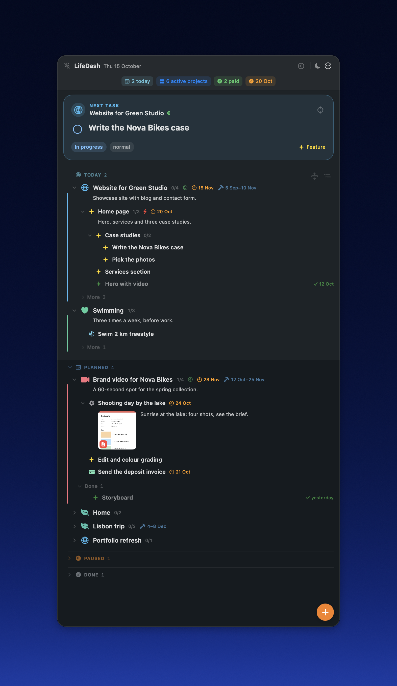
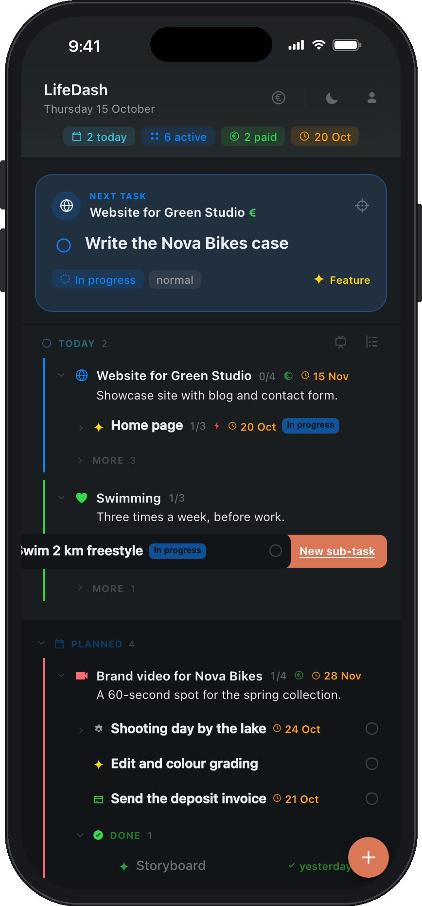
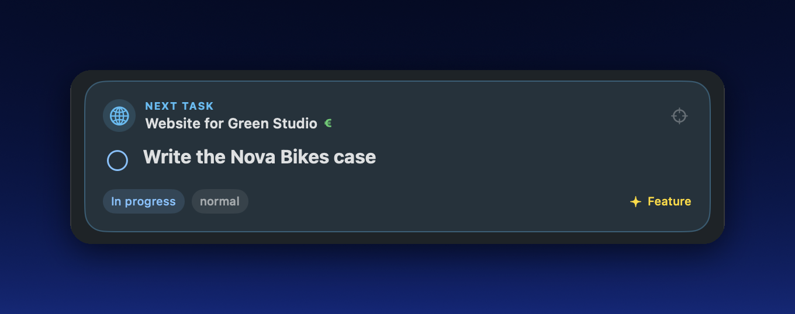
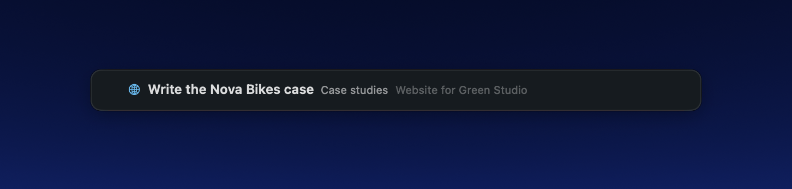
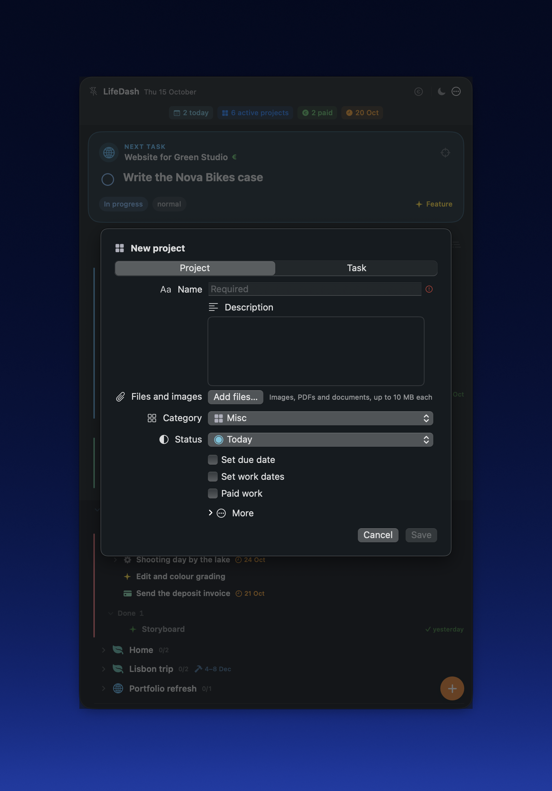
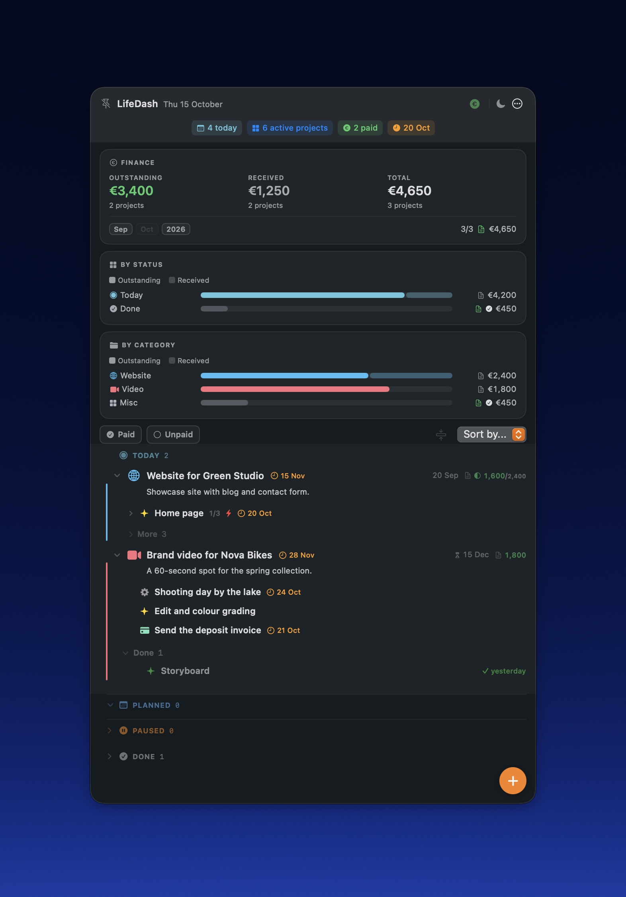

<p align="center"></p>

<h1 align="center">LIFEDASH</h1>

<p align="center"><b><a href="https://github.com/antarcorrado/lifedash/releases/latest/download/LifeDash.zip">Download for Mac</a></b> · <b><a href="https://www.antarcorrado.com/lifedash/">Open the web app</a></b><br>macOS 13 or later · Apple Silicon and Intel · free</p>

**Start from your work, and give the rest of your day the same care.** LifeDash
puts the client project, the video you are editing and the invoice to send
next to the swim before work, the shelf you want to put up and the trip in
December. Each area of your life is a project, each thing to do is a task, and
the app always shows you the next step, so the day feels like a list of small
wins instead of a pile of worries.

**It adapts to you, not the other way round.** Your own categories, task
types, icons and colours, sub-tasks as deep as a project needs: everyone ends
up with their own method.

**Built to work with AI agents.** Claude Code, Codex, Cursor and other agents
can read your projects, add tasks and tick them off through the `lifedash`
command, which the app installs together with the instructions the agents need.
No heavy integration to set up: it is a small command with compact output, so
an agent spends very few tokens to use it.

It is a native Mac app and a web app for your phone, in English and Italian,
kept in sync and encrypted end to end: your data stays yours.

<p align="center"></p>

## What it is for

- **Work first**: client projects and freelance jobs, with their tasks,
  deadlines, fees, invoices and instalments. Tick things off as you go and
  watch the project move forward.
- **Your own projects**: the portfolio to refresh, the course you are taking,
  the side project you finally want to ship.
- **Sport and health**: the pool three times a week, the run on Sunday, a
  goal to reach and the habits that get you there.
- **Home and plans**: the shelf to put up, herbs for the balcony, flights and
  a hotel for the next trip.
- **The few things with a date**: renewing a pass or sending an invoice gets a
  due date and a gentle reminder, so nothing slips and nothing nags.
- **Your way of working**: create your own categories for projects and your
  own types for tasks, each with the icon and colour you choose. A designer,
  a developer, a student and a coach will each shape LifeDash differently,
  and that is the point: there is no method to adopt, only yours to build.

## How it works, in one minute

1. **Projects** are the areas of your life (Home, Health, a trip, a client),
   organised with categories you define.
   Each one has a status: *Today* (active now), *Planned*, *Paused* or
   *Done*.
2. **Tasks** live inside projects, and every task can hold its own
   sub-tasks, which can hold theirs, with no limit: a page of a website, the
   sections of that page, the pieces of each section. Shape every project the
   way it really is, from a two-step errand to a client job with dozens of
   parts. A task can be *to do*, *in progress*, *blocked* (with a note on why)
   or *done*, and can be marked *urgent*.
3. **Next task.** The card at the top shows the one thing to do now: the
   first open task of your first active project, starting with what is
   already in progress. Marking a task *urgent* moves it to the top of its
   project; tick it and the next one appears.
4. **Due dates and reminders.** Give a task or project a date and choose when
   to be reminded (a day before, an hour before...). The Mac shows the
   notification; on your phone it arrives as a push notification, even with
   the Mac switched off.
5. **Everything syncs.** Change something on the Mac and it is on your phone
   a few seconds later, and the other way round.

## Get started

### On the Mac

1. Download **[LifeDash.zip](https://github.com/antarcorrado/lifedash/releases/latest/download/LifeDash.zip)**,
   open it and drag **LifeDash** to Applications.
2. Open LifeDash. The app is signed and notarised by Apple, so it opens
   without warnings.
3. Press **+** to create your first project, then add tasks to it. That's it:
   LifeDash works on the Mac even without an account.

The interface follows the language of your Mac: Italian on an Italian system,
English everywhere else.

### On your phone (and any browser)

1. On the Mac, open **Account** and create an account: choose a username and
   a password, then scan the QR code with an authenticator app (Google
   Authenticator, 1Password, Authy...).
2. **Save the recovery kit** the app gives you. It is the only way back in if
   you forget your password: nobody, not even the server administrator, can
   read or recover your data without it.
3. On the phone, open **[antarcorrado.com/lifedash](https://www.antarcorrado.com/lifedash/)**,
   sign in, and add it to the Home Screen (Safari: Share › Add to Home Screen).
   It then opens like an app, works offline, and can send notifications.
   The web app follows your browser's language; you can change it in
   **Account › Language**.

You can also create the account directly from the web app and use LifeDash
only in the browser, on any computer.

<p align="center"></p>

## One task at a time

The way LifeDash is meant to be used, day to day: don't stare at the whole
list, pick the next step and finish it.

<p align="center"></p>

1. **Look at the Next task card.** It sits at the top of the list and shows
   the one thing to do now: the first open task of your first active project,
   starting with what is already in progress.
2. **Work on that, and only that.** Everything else can wait in the list.
3. **Tick it.** The check mark completes it, the card moves on to the next
   task, and you start again.

Planning happens in the list (order projects and tasks, mark something
*urgent* to move it to the top); doing happens in the card, one task at a
time. When you don't need the card, a double-click hides it, and the target
icon brings it back.

**Compact mode** (Mac, *View › Compact Mode*) takes this one step further:
the window folds into a slim bar at the edge of the screen with only the next
task, the task it belongs to and its project. It can stay on top of your other
windows while you work, so the next step is always in sight and nothing else
is. Move the pointer over the bar and the check mark appears: tick the task
and the bar shows the following one. Double-click the bar to go back to the
full dashboard.

<p align="center"></p>

## Everyday use

- **Add**: the round **+** button creates a project or a task. Inside a
  project, the **+** on a row adds a sub-task.
- **Swipe** (phone and tablet): swipe a row to the right to edit it, to the
  left to add a sub-task or a task inside it.
- **Edit**: click (or tap) a row, or the pencil, to open the editor: title,
  description, status, priority, due date, reminders, attachments.
- **Tick**: the check mark completes a task. Completed tasks fold away under
  *Done*, with the date they were closed.
- **Lists become sub-tasks**: write a description as a list (`- Milk`,
  `- Bread`) and each line becomes a sub-task you can tick on its own.
- **Attachments**: add photos, PDFs and documents (up to 10 MB each) to any
  project or task: the client's brief, a reference photo, the quote. PDFs and
  images show a preview right under the description.
- **Fold and focus**: every project and task with sub-tasks is an accordion.
  Open only what you are working on; the app remembers.
- **Make it yours**: next to the category and type menus in the editor, the
  pencil opens the list, where you add, rename, reorder and delete categories
  and types and give each one an icon and a colour.
- **Duplicate** a project or task to reuse it (the monthly shopping, a
  recurring check-up).
- **Compact mode** (Mac, *View › Compact Mode*): see *One task at a time*
  above.

<p align="center"></p>

## Money: the Finance view

Your work pays: press the **€** button to see only the projects that involve money. For each
one you can set an amount, whether it has been paid and when, whether an
invoice was issued, and split a payment into instalments. At the top you see
what you are owed, what you have received and the total, by month and by
year, by status and by category.

<p align="center"></p>

Outside the Finance view, amounts stay hidden. A paid project only shows a
small **€** next to its name, which tells you how things stand at a glance
without showing a single figure, even with someone looking at your screen:

| Icon | Meaning |
|---|---|
| empty € | the work is still to be paid |
| half-filled € | part of it has arrived |
| filled € | paid in full |

## Your data, your privacy

- **End-to-end encryption.** Your Mac and your browser encrypt everything
  (AES-256-GCM) *before* sending it. The server keeps your data, so it is
  there on every device, but only as unreadable blobs: it cannot see your
  projects, tasks or attachments.
- **Two-factor sign-in.** Every new device needs your password and a code from
  your authenticator app.
- **Download everything.** In the web app, **Account › Your data › Download
  all data** gives you a zip with all your projects and tasks (`tasks.json`)
  and every attachment, decrypted on your device.
- **Delete your account.** **Account › Delete account** removes your account
  and every piece of your data from the server, for good.
- **No tracking.** No analytics, no ads, no third-party scripts.

## Use it from the command line and AI agents

The `lifedash` command reads and changes your projects and tasks from the
Terminal, so a script or an AI agent (Claude Code, Codex and others) can add a
task when a job is done, list what is due this week, or tick something off.
It ships inside the Mac app, which installs it the first time you open it,
and it needs [Node.js](https://nodejs.org) 18 or later.

**1. Check that it is there:**

```bash
lifedash --help
```

The app links the command into the first folder it can write among
`/opt/homebrew/bin`, `/usr/local/bin` and `~/.local/bin`. If your Terminal
answers *command not found*, that folder is not in your `PATH`: add it, or
call the command by its full path,
`/Applications/LifeDash.app/Contents/Resources/cli/lifedash.mjs`.

**2. Give it a token.** A script cannot type your password and a 6-digit code,
so the command signs in with a token instead. In the web app open **Account ›
Tokens for scripts and agents** (on the Mac: **Account › Tokens for scripts
and agents › New token…**), give it a name and choose *read only* if the agent
should only look. Copy the token, then:

```bash
lifedash login        # paste the token and press Enter
lifedash whoami       # checks that it works
```

The token stays in `~/.config/lifedash/credentials.json`, readable only by
you. It opens your data without your password, so treat it like one: you can
see every token in the Account panel and revoke it at any time.

**3. Use it:**

```bash
lifedash projects                                  # open projects
lifedash tasks --open --sort due                   # what is still to do, by due date
lifedash task add --project green-studio --title "Send the mockups" --due 2026-11-03
lifedash task start task-1a2b3c4d                  # in progress
lifedash task done task-1a2b3c4d                   # tick it off
lifedash --help                                    # every command and option
```

Messages are in English, or in Italian when your system language is Italian.

**AI agents learn it by themselves.** The app also installs a *skill*, the
instructions an agent reads to use the command well, in the skill folders of
the agents you have: Claude Code and the Claude app (`~/.claude/skills`),
Codex, Cursor, Gemini CLI, GitHub Copilot and OpenCode. Then just ask:

> Add a task to my Green Studio project for every change in this email, and
> mark the hero video as done.

The skill and the command are links into the app, so they update with it.

## Updates

LifeDash checks for a new version every time it opens, downloads it in the
background and installs it when you quit. When an update is ready, the
*LifeDash* menu offers **Restart to Update**; **Check for Updates…** looks
right away.

## Requirements

- Mac app: macOS 13 Ventura or later, Apple Silicon or Intel.
- Web app: any recent browser. Push notifications on iPhone need iOS 16.4 or
  later and the app added to the Home Screen.

## Feedback

Found a bug or have an idea? [Open an issue](https://github.com/antarcorrado/lifedash/issues).

## License

Free to use. See [LICENSE](LICENSE).
